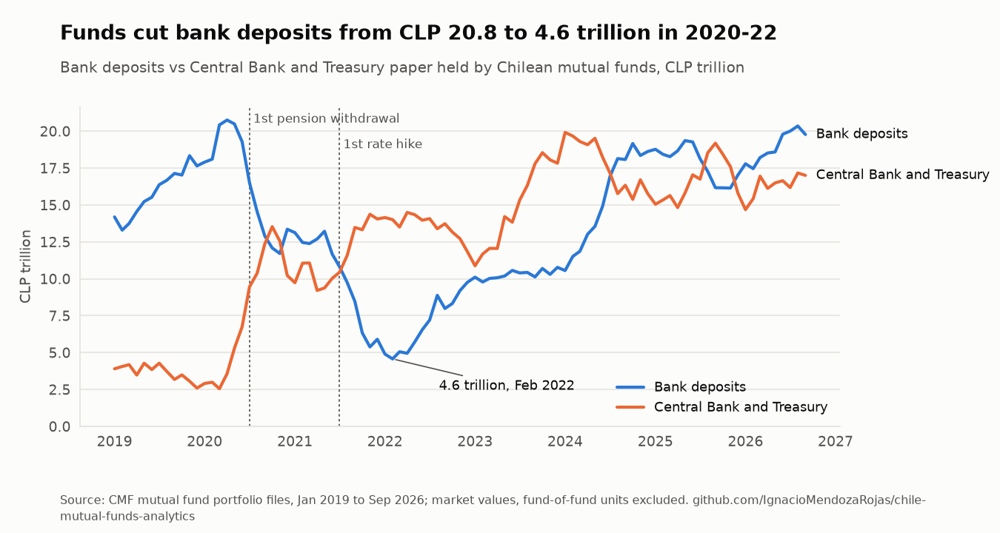

# chile-mutual-funds-analytics

[](https://github.com/IgnacioMendozaRojas/chile-mutual-funds-analytics/actions/workflows/ci.yml)
[](https://github.com/IgnacioMendozaRojas/chile-mutual-funds-analytics/actions/workflows/update.yml)

**Liquidity risk and bank funding.** Every Chilean mutual fund's holdings, month by month since January 2019, read as a liquidity-risk question: how much short-term funding banks get from mutual funds, how concentrated it is, and how fast it can leave.

> At Banco Ripley I work on liquidity risk (deposit balance decay, ILAAP projections under Basel III, cash-flow stress tests) and collect fund and portfolio data with Python and web scraping. This repository applies the same work to public data: 3.2 million holdings and 156,000 derivative positions filed with the CMF, kept current by a scheduled workflow. No bank data or parameters.

## Results

- **Six banks take 78% of the CLP 38.5 trillion that mutual funds lend to banks**, and 56% of funds' domestic fixed income matures within a year: a large, concentrated and short source of funding.
- **It has run before.** Funds' bank deposits fell 25% in one month (October 2021), 45% in three months and 63% in twelve, from CLP 20.8 trillion (April 2020) to 4.6 trillion (February 2022). Those are observed run-off rates a liquidity stress test can be calibrated on.
- **Most foreign exposure is unhedged.** Only 12% of CLP 10.4 trillion in foreign-currency assets is covered by US dollars sold forward, and the share fell as the assets doubled after 2024.

<picture>
  <source media="(prefers-color-scheme: dark)" srcset="docs/figures/banks-dark.png">
  
</picture>

## What this shows

| Task in a liquidity-risk team | Where it is done here |
|---|---|
| Measure funding concentration by provider and by bank | Bank funding by issuer and issuer HHI, every month ([`analysis.py`](src/ffmm/analysis.py)) |
| Calibrate run-off rates for a stress scenario | Worst 1-, 3- and 12-month outflows on record ([`outflows.csv`](data/processed/outflows.csv)) |
| Track the maturity profile of wholesale funding | Share maturing within a year and average remaining maturity |
| Check FX risk and hedging of a portfolio | Foreign-currency assets against USD forwards, fund by fund, with dirty forward rows cleaned |
| Collect regulatory data that has no API | [cmf-ffmm-etl](https://github.com/IgnacioMendozaRojas/cmf-ffmm-etl) reads the portal and runs quality checks; this repository adds the analysis |
| Keep a report current without manual work | A scheduled workflow adds each month, regenerates figures and the table below, and fails loudly on bad files |

## Latest reading

<!-- latest:start -->
**Latest reading: September 2026.** Mutual funds held CLP 38.5 trillion of bank deposits and bonds in September 2026, 49% of everything they own; the six largest banks take 78%.

| Indicator | Latest | Month before | Change | Note |
|---|---:|---:|---:|---|
| Bank deposits and bonds held by funds | CLP 38.5 tn | CLP 38.8 tn | -0.7% |  |
| Share of fund holdings lent to banks | 48.6% | 49.1% | -0.5 pp |  |
| Share taken by the six largest banks | 78.2% | 78.6% | -0.4 pp |  |
| Domestic fixed income maturing within a year | 56.0% | 57.1% | -1.2 pp |  |
| Average remaining maturity, domestic fixed income | 1.89 years | 1.80 years | +0.09 |  |
| Total holdings (fund-of-fund units excluded) | CLP 79.2 tn | CLP 79.0 tn | +0.2% |  |
| Foreign-currency assets hedged with US$ forwards | 11.8% | 11.2% | +0.6 pp |  |

*Updated automatically on 2026-10-22 from the CMF files. CLP tn = CLP trillion (10^12). A note gives the month when an indicator lags the others.*
<!-- latest:end -->

## Findings, as of September 2026

**1. The industry more than doubled, to CLP 79 trillion.** Holdings at market value went from CLP 32.9 trillion in January 2019 to CLP 79.2 trillion in September 2026. Fund units held by other funds are excluded, so nothing is counted twice. Almost all of the growth came after 2023.

<picture>
  <source media="(prefers-color-scheme: dark)" srcset="docs/figures/composition-dark.png">
  
</picture>

**2. In 2020-22 the money left the banks for the Central Bank, then came back.** Bank deposits held by funds fell from CLP 20.8 trillion (April 2020) to CLP 4.6 trillion (February 2022), while Central Bank paper rose from CLP 2.0 trillion to CLP 13.2 trillion. The timing coincides with the pension-fund withdrawals (from July 2020) and the Central Bank's rate hikes (from July 2021). The issuer concentration index (HHI) of domestic fixed income went from about 700 to 2,522, because a single issuer, the Central Bank, held over a third of the portfolio. Bank deposits only recovered their January 2019 level in mid-2024.

<picture>
  <source media="(prefers-color-scheme: dark)" srcset="docs/figures/funding-shift-dark.png">
  
</picture>

**3. Mutual funds are a large, concentrated source of bank funding.** In September 2026 funds held CLP 38.5 trillion in bank deposits and bank bonds, 49% of everything they own. Six banks take 78% of it, each between 12% and 14%: Santander, Itaú, BICE, Banco de Chile, Scotiabank and BCI. More than half of domestic fixed income (56%) matures within a year, so this money is short-term and can leave quickly. For a bank's liquidity-risk team, that is the reason to watch this data.

**4. Duration followed the rate cycle.** The market-value-weighted remaining maturity of domestic fixed income was about 2.0 years in 2019-2021. It fell to 1.26 years in October 2023, when 75% of it matured within a year, and is back to 1.9 years (56% within a year). The inflation-linked (UF) share went from a low of 26% (April 2020) to 44%.

<picture>
  <source media="(prefers-color-scheme: dark)" srcset="docs/figures/maturity-dark.png">
  
</picture>

**5. Most foreign exposure is not hedged, and less of it is hedged as it grows.** Foreign-currency assets went from CLP 4.4 trillion in January 2024 to CLP 10.4 trillion in September 2026. US dollars sold forward covered 9% to 24% of those assets over 2019-2026 (median 14%), and 11.8% in September 2026. Of the funds with at least CLP 1 billion abroad, only 10% hedge half or more, down from 16% in January 2024. The ratio was lowest in March 2022 (8.7%) and again in September 2025 (9.6%), each time after a build-up of foreign assets.

<picture>
  <source media="(prefers-color-scheme: dark)" srcset="docs/figures/fx-hedge-dark.png">
  
</picture>

**6. Chilean equity holdings grew 2.5x, led by Falabella and LATAM.** Holdings went from CLP 1.9 trillion to CLP 4.7 trillion. The largest positions in September 2026 are Falabella and LATAM (about CLP 0.5 trillion each), then Banco Santander-Chile, BCI and SQM-B. Funds' SQM-B holding more than doubled during 2025, from CLP 157 billion in January to CLP 323 billion in December, and stood at CLP 342 billion in September 2026; the [equity-research-engine](https://github.com/IgnacioMendozaRojas/equity-research-engine) values that stock.

Every number above comes from the tables in [`data/processed`](data/processed). The table at the top updates itself every month; the findings are reviewed by hand.

## How it stays current

[`update.yml`](.github/workflows/update.yml) runs on the 16th and 26th of each month (the CMF publishes month M around days 10-15 of M+1):

1. `ffmm update` downloads only the months missing from the tables (three files each) and aggregates them. Every table in `data/processed` is built month by month, so the raw files, about 70 MB a year, are never stored.
2. `ffmm build` redraws the figures and writes [`latest.json`](data/processed/latest.json) and the table at the top of this README.
3. The months that passed are committed. A blocked file or a gap in the series fails the run and GitHub sends an email; nothing is published for that month.

A full rebuild from 2019 (`--rebuild`, about an hour on GitHub) reproduces the published tables.

## Method and data quality

- **Source.** The CMF statistics portal publishes five portfolio files per month (NACI domestic, EXTR foreign, FUTU forwards and swaps, OPCI and OPLA options), with columns coded under CMF Circular 1333. The portal has no API. Files are read through [cmf-ffmm-etl](https://github.com/IgnacioMendozaRojas/cmf-ffmm-etl), which reproduces the browser (form session, then POST), runs its quality checks and returns typed columns; a file that fails a blocking check is not used.
- **Units.** Market values are in thousands of CLP; tables report CLP billion (10^9). Currency code `PROM` is the US dollar (USD forwards strike at about 900). `CA` and `CU` mark share and fund-unit counts, not currencies.
- **No double counting.** Units of other mutual funds (`CFM`) are left out of the industry totals.
- **Bank names** are read from each issuer's deposit tickers (`FNSTD-…` is Santander), not typed in by hand.
- **Forward cleaning.** The committed amount should equal notional × strike. Four rows reported it in pesos instead of thousands of pesos and are rescaled. 10,682 USD-forward rows (12% over 2019-2026) have an implied rate nowhere near the strike, typically a notional reported in pesos. They cannot be repaired and are excluded, so the hedge ratio is a lower bound. Interest-rate and UF swaps are not counted as FX hedges.
- **Not covered.** Fund flows and returns (they need the CMF's daily fund-unit data), and fund-of-fund look-through.

## Use

```bash
pip install -e ".[dev]"
ffmm update                     # add missing months to data/processed (--rebuild to recompute all)
ffmm build                      # figures, latest.json, README block
pytest                          # tests on real rows from the CMF files
```

```
src/ffmm/
  source.py     one month from the CMF through cmf-ffmm-etl, with analysis columns
  analysis.py   composition, bank funding and HHI, risk profile, FX hedge, equities
  monthly.py    one month -> the rows of every published table
  update.py     add missing months, report gaps
  build.py      figures, latest.json, README block
  schema.py     asset classes, currency, bank and rating labels
```
