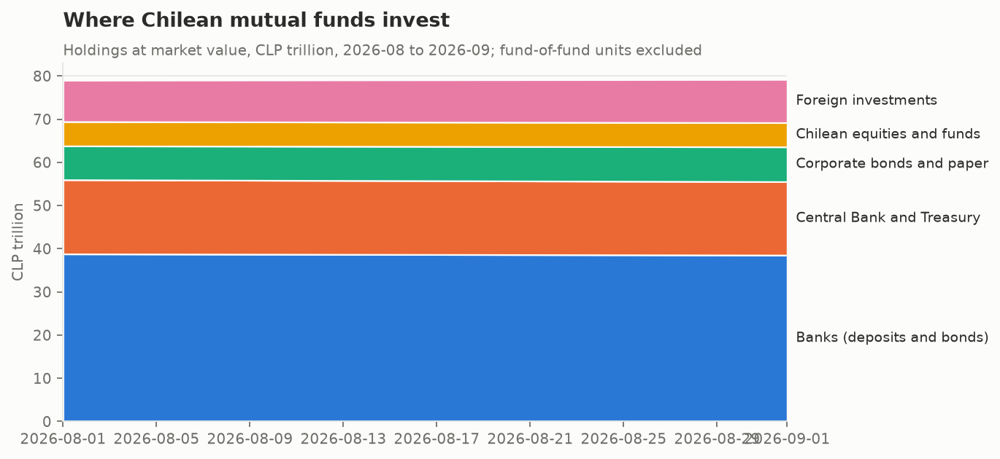
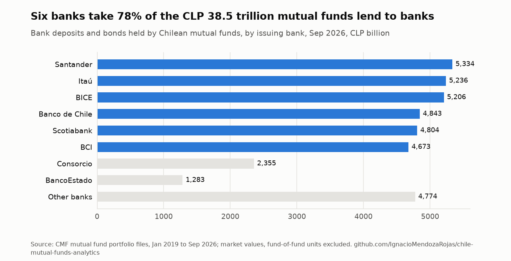
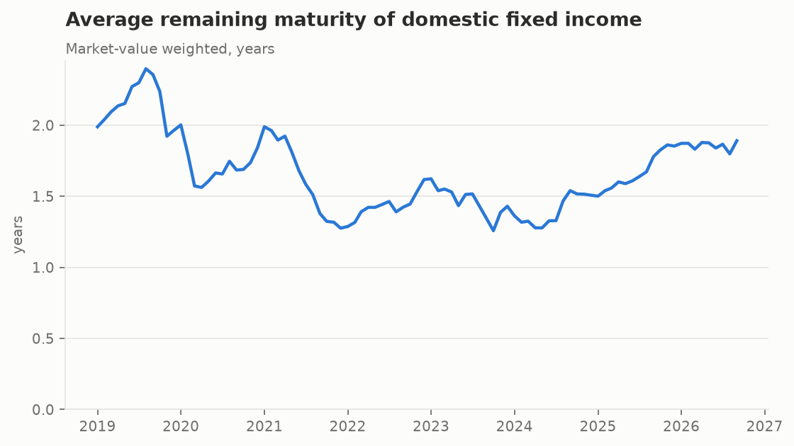
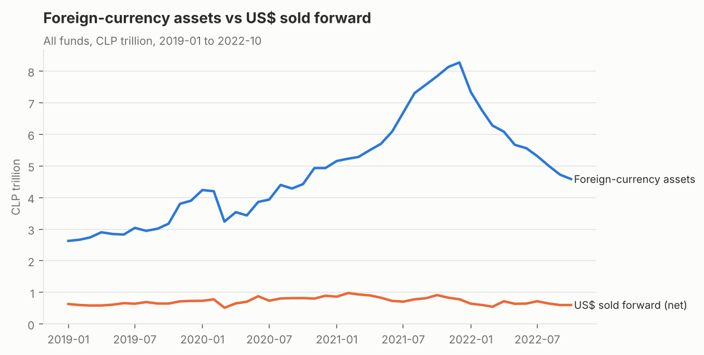

# chile-mutual-funds-analytics

[](https://github.com/IgnacioMendozaRojas/chile-mutual-funds-analytics/actions/workflows/ci.yml)

What Chilean mutual funds hold, month by month, from January 2019 to September 2026. The source is every fund's portfolio as filed with the CMF (Comisión para el Mercado Financiero). That is 3.3 million holdings across about 450 funds, read from the public files and turned into a few questions a risk analyst would ask.

Companion to [cmf-ffmm-etl](https://github.com/IgnacioMendozaRojas/cmf-ffmm-etl), which loads the same files into a database. This repository is the analysis layer.

<picture>
  <source media="(prefers-color-scheme: dark)" srcset="docs/figures/composition-dark.png">
  
</picture>

<!-- latest:start -->
<!-- latest:end -->

## Findings

**1. The industry more than doubled, to CLP 79 trillion.** Holdings at market value went from CLP 32.9 trillion in January 2019 to CLP 79.2 trillion in September 2026. Fund units held by other funds are excluded, so nothing is counted twice. Almost all of the growth came after 2023.

**2. In 2021-22 the money left the banks for the Central Bank, then came back.** Bank deposits held by funds fell from CLP 13.1 trillion (January 2021) to CLP 4.6 trillion (February 2022). Over the same months, Central Bank paper rose from CLP 6.6 trillion to CLP 13.4 trillion. The timing coincides with the pension-fund withdrawals and the start of the Central Bank's rate hikes. The issuer concentration index (HHI) of domestic fixed income went from about 700 to 2,522, because a single issuer, the Central Bank, held over a third of the portfolio. Bank deposits only recovered their January 2019 level in mid-2024.

**3. Mutual funds are a large, concentrated source of bank funding.** In September 2026 funds held CLP 38.5 trillion in bank deposits and bank bonds, 49% of everything they own. Six banks take 78% of it, each between 12% and 14%: Santander, Itaú, BICE, Banco de Chile, Scotiabank and BCI. More than half of domestic fixed income (56%) matures within a year, so this money is short-term and can leave quickly. For a bank's liquidity-risk team, that is the reason to watch this data.

<picture>
  <source media="(prefers-color-scheme: dark)" srcset="docs/figures/banks-dark.png">
  
</picture>

**4. Duration followed the rate cycle.** The market-value-weighted remaining maturity of domestic fixed income was about 2.0 years in 2019-2021. It fell to 1.26 years in October 2023 and is back to 1.9 years. The inflation-linked (UF) share went from a low of 26% (April 2020) to 44%.

<picture>
  <source media="(prefers-color-scheme: dark)" srcset="docs/figures/maturity-dark.png">
  
</picture>

**5. Most foreign exposure is not hedged.** Between January 2019 and October 2022, US dollars sold forward covered only 9% to 24% of the industry's foreign-currency assets. The median month was 18%. Of the funds with at least CLP 1 billion abroad, only 12-20% hedged half or more. The ratio was lowest in March 2022, after the foreign assets built up in 2021. The forward data ends in October 2022 because the download stopped there; `ffmm download` brings it up to date.

<picture>
  <source media="(prefers-color-scheme: dark)" srcset="docs/figures/fx-hedge-dark.png">
  
</picture>

**6. Chilean equity holdings grew 2.5x, led by Falabella and LATAM.** Holdings went from CLP 1.9 trillion to CLP 4.7 trillion. The largest positions in September 2026 are Falabella and LATAM (about CLP 0.5 trillion each), then Banco Santander-Chile, BCI and SQM-B. Funds' SQM-B holding more than doubled during 2025, from CLP 157 billion in January to CLP 323 billion in December, and stood at CLP 342 billion in September 2026; the [equity-research-engine](https://github.com/IgnacioMendozaRojas/equity-research-engine) values that stock.

Every number above comes from the tables in [`data/processed`](data/processed), which `ffmm build` regenerates.

## Method and data quality

- **Source.** The CMF statistics portal publishes five portfolio files per month (NACI domestic, EXTR foreign, FUTU forwards and swaps, OPCI and OPLA options), with columns coded under CMF Circular 1333. The portal has no API, so `ffmm download` reproduces the browser: it loads the form for a session cookie, then posts month, year and portfolio code. Files are stored untouched, gzip-compressed, and a re-run skips what is already there.
- **Units.** Market values are in thousands of CLP; tables report CLP billion (10^9). Currency code `PROM` is the US dollar (USD forwards strike at about 900). `CA` and `CU` mark share and fund-unit counts, not currencies.
- **No double counting.** Units of other mutual funds (`CFM`) are left out of the industry totals.
- **Bank names** are read from each issuer's deposit tickers (`FNSTD-…` is Santander), not typed in by hand.
- **Forward cleaning.** The committed amount should equal notional × strike. Four rows reported it in pesos instead of thousands of pesos and are rescaled. 3,160 USD-forward rows (7%) have an implied rate nowhere near the strike, typically a notional reported in pesos. They cannot be repaired and are excluded, so the hedge ratio is a lower bound. Interest-rate and UF swaps are not counted as FX hedges.
- **Not covered.** Fund flows and returns (they need the CMF's daily fund-unit data), and fund-of-fund look-through.

## Use

```bash
pip install -e ".[dev]"
ffmm download --start 2019-01            # NACI, EXTR, FUTU; about 1.5 s per file, resumable
ffmm build                               # data/processed/*.csv and docs/figures/*.png
pytest                                   # 8 tests on real rows from the CMF files
```

Raw files go to `data/raw/` (git-ignored, about 70 MB for 2019-2026). Only the aggregated tables are committed.

```
src/ffmm/
  download.py   CMF portal client (form session + POST), resumable
  schema.py     Circular 1333 column codes, asset classes, currency and bank labels
  read.py       raw file -> typed table (units, maturities, asset class)
  analysis.py   composition, bank funding and HHI, risk profile, FX hedge, equities
  build.py      tables + figures
```
